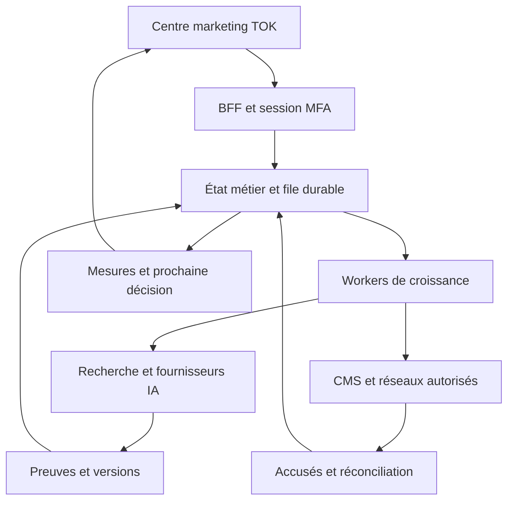

# Moteur de croissance TOK — conception proposée et audit de parité

Date de l’audit : 1er novembre 2026. **Statut : conception à valider, aucun moteur nouveau livré.** Le propriétaire a choisi le **moteur TOK autonome** parmi les approches native, intégration BabyLoveGrowth et hybride. Ce choix valide l’orientation ; ce document reste une proposition technique. Les fonctions décrites comme cibles ci-dessous ne sont pas des fonctions déjà disponibles.

## 1. Résultat attendu

Depuis `marketing.thetok.ch`, gérer toute la chaîne de croissance organique : comprendre TOK et ses offres réelles, rechercher les sujets, planifier et produire les articles, les publier, décliner les contenus sur les réseaux, contrôler la santé SEO, mesurer le trafic et les réponses des moteurs IA, puis adapter le prochain cycle. Conserver les campagnes, audiences, approbations, sessions MFA et publications TOK existantes.

La cible est une **équivalence fonctionnelle observable avec les fonctions documentées de BabyLoveGrowth**, dans l’identité TOK et avec un moteur propre. L’algorithme privé, les données commerciales et le réseau de partenaires du fournisseur ne sont pas accessibles par son API d’articles. Une parité complète ne doit donc pas être déclarée à partir d’une interface ou d’un import d’articles.

L’évaluation finale utilisera la matrice de la section 4. Chaque exigence conservera un état réel : `à développer`, `développé`, `testé localement`, `validé en environnement de recette`, `validé sur le fournisseur`, `activé`. Un prérequis inaccessible donnera `bloqué` avec sa cause. Une phase livrée ne fermera pas les exigences des phases suivantes.

## 2. Constats vérifiés et limites de l’audit

### Dépôt et hébergement

- Dépôt lu : `Mtnrconcept1/cloud-rebuild`, référence de départ `20aafebff88ccb683cd45424280f631e4ca3b114`, après `git fetch --prune origin` ; 3 882 fichiers suivis. Checkout de départ sur `main`, avec un fichier temporaire non suivi appartenant à un autre travail, laissé intact.
- Travail isolé dans la branche créée `agent/marketing-growth-parity-20261101`. Les instructions racine `AGENTS.md`, les règles applicatives, SEO, tests, RLS et release ont été consultées.
- Stack déclarée : React `^18.3.1`, Vite `^6.4.3`, TypeScript `^5.8.3`, Supabase JS `^2.106.2`, OpenAI SDK `^6.39.1`, Vitest `^4.1.11`. Ce sont les contraintes de `package.json` ; le lockfile reste l’autorité pour les versions résolues.
- Projet Vercel confirmé : `cloud-rebuild-recovered`, `prj_v4X2Bhefbcf12CVIanrvS62q9Vy6`. `marketing.thetok.ch` est rattaché à ce projet et marqué vérifié.
- La CI et le workflow de production existants ont été lus. Le déploiement Git automatique est désactivé dans `vercel.json` ; la production passe par `deploy-production.yml`. Ce chantier ne doit pas changer cette stratégie.
- L’accès public au centre marketing aboutit à la connexion dédiée avec MFA. Aucun parcours administrateur connecté n’a été testé dans ce navigateur. L’inventaire navigateur disponible ne contient pas de session BabyLoveGrowth connectée ; la parité ci-dessous provient de sa documentation officielle, pas d’une inspection exhaustive du compte privé.

### Backend et intégrations

Projet Supabase confirmé par le connecteur : **Tok**, `wwcrtyoueexyxkkikaos`, actif, région `eu-central-2`. Requêtes d’audit exclusivement en lecture, sur les schémas et les états techniques ; aucune donnée personnelle ni valeur de secret utilisée dans ce document.

| Observation distante | Ce qu’elle établit | Ce qu’elle ne prouve pas |
| --- | --- | --- |
| 36 tables marketing de base, RLS activée sur les 36, forcée sur 27 | Socle de données marketing déjà déployé | Exactitude de chaque policy ou droit effectif de tous les rôles |
| Fonctions Edge marketing actives : orchestrateur, agent IA, webhook, désinscription | Présence des fonctions déployées | Réussite de leurs appels fournisseur aujourd’hui |
| Facebook, Instagram, Resend et notifications internes marqués `connected` dans `marketing_integrations` | Dernier état enregistré disponible | Validité actuelle des tokens et réussite d’un canari |
| Search Console marqué `unconfigured`, adaptateur absent dans le registre des fournisseurs | La liaison du centre marketing n’est pas prête selon son registre | Absence d’un accès Google utilisé par un autre outil de l’utilisateur |
| Metricool marqué `unconfigured` dans ce même registre | Pas de connecteur backend confirmé dans ce registre | Absence de suivi web Metricool ou de compte connecté dans ChatGPT |
| Aucun nom Google/OpenAI/Gemini/Anthropic/Reddit/Quora/Metricool/BabyLoveGrowth trouvé par la recherche ciblée dans les noms Vault | Résultat de cet inventaire Vault uniquement | Absence de secrets Edge, GitHub, Vercel ou de credentials stockés par un autre mécanisme |

La liste des variables Vercel a été consultée sans déchiffrement et réduite à leurs noms/types/cibles. La réponse est partiellement tronquée : elle ne constitue pas un inventaire exhaustif. Les credentials d’exécution des nouveaux fournisseurs restent à vérifier par leurs sondes serveur. L’accès d’un connecteur ChatGPT n’équipe pas automatiquement le backend TOK d’un credential durable.

### Code déjà utilisable

| Domaine | Points d’entrée réellement présents |
| --- | --- |
| Workspace et navigation | `src/pages/marketing/MarketingWorkspace.tsx`, `src/components/marketing/MarketingWorkspaceChrome.tsx`, `src/marketing/types.ts`, `src/marketing/useMarketingUrlState.ts` |
| Sessions privilégiées, CSRF, opérations | `server/marketingBff.ts`, `api/marketing/rpc.ts`, `api/marketing/agent.ts`, `api/marketing/orchestrator.ts`, `src/marketing/marketingBffClient.ts` |
| Campagnes, calendrier, audiences, résultats | `src/marketing/marketingClient.ts`, `src/marketing/useMarketingOperations.ts` et les vues de `src/components/marketing/views/` |
| IA et images | `supabase/functions/ai-marketing-agent/index.ts`, `_shared/marketing-ai.ts`, `_shared/marketing-brand.ts`, `_shared/marketing-visual.ts` |
| Traitement et publication sociale | `supabase/functions/marketing-orchestrator/index.ts`, `_shared/meta-marketing-orchestrator.ts`, `_shared/marketing-daily-generation.ts` |
| Veille et liens | `_shared/marketing-backlink-discovery.ts`, `_shared/marketing-backlink-sources.ts`, `MarketingOutreachView.tsx`, `MarketingInstagramView.tsx` |
| Gouvernance et mesure | `src/marketing/autopilotTypes.ts`, `src/marketing/autopilotClient.ts`, `docs/marketing/analytics-evidence.md`, `docs/marketing/GROWTH_AUTOPILOT.md` |

Les chemins `_shared/` de ce tableau sont relatifs à `supabase/functions/`. Les deux vues citées dans « Veille et liens » sont dans `src/components/marketing/views/`.

Les 13 vues actuelles sont : overview, agent, calendar, campaigns, audiences, automations, activity, results, integrations, governance, faq, outreach, instagram. Aucune vue dédiée à un CMS d’articles, au suivi de prompts IA ou à un audit technique SEO n’est déclarée dans ce registre. L’inspection des noms de tables `public`/`private` n’a pas trouvé de table dédiée aux articles de blog, à GA4 ou aux réponses des modèles IA. Cette recherche par noms n’exclut pas des données présentes ailleurs.

La documentation historique contredit parfois le code actuel : elle indique encore une absence d’adaptateur Meta alors que l’orchestrateur importe et utilise cet adaptateur. Les futurs travaux doivent suivre le code réel et les sondes, et actualiser les documents concernés.

### Blog existant et travaux concurrents

Le blog public expose deux articles :

- `https://blog.thetok.ch/blog/restaurant-a-emporter`
- `https://blog.thetok.ch/blog/livraison-repas-geneve`

Les médias de couverture utilisent `media.babylovegrowth.ai`. La première page a été lue : introduction explicative, encart TOK, résumé, sommaire, sous-sections pratiques, tableaux, liens internes, FAQ et sources. C’est une référence éditoriale, pas une validation automatique de toutes ses affirmations commerciales. Le fournisseur d’hébergement et le contrôle DNS du blog restent à confirmer avant la bascule.

Les cinq commits récents récupérés couvrent les utilisateurs admin (#1059), l’accueil mobile (#1058), la fiabilité des visuels marketing (#1056), l’AutoPilot/acquisition/Metricool (#1054) et le mode coming soon (#1051). La PR ouverte #1055 touche notamment la génération quotidienne, Metricool et les index documentaires ; elle n’a pas été fusionnée par cet audit. D’autres PR ouvertes concernent les visuels et le SEO. Revalider leurs états et leurs chemins avant de commencer chaque lot. L’issue existante #692 sert déjà de suivi du marketing AutoPilot : relier le futur chantier à ce suivi sans fermer ses lacunes par anticipation.

## 3. Approches étudiées

| Approche | Apport | Limite | Décision |
| --- | --- | --- | --- |
| Moteur TOK autonome sur le socle existant | Contrôle des contenus, données, règles et évolutions ; moteur réutilisable | Développement de plusieurs domaines et accès fournisseurs propres ; réseau partenaires à constituer | **Choisie par le propriétaire** |
| Connecter uniquement l’API BabyLoveGrowth | Synchronisation des articles déjà produits | Les endpoints documentés ne pilotent pas tout le produit | Non retenue comme architecture cible |
| Hybride avec services BabyLoveGrowth | Transition et conservation éventuelle de services privés | Dépendance au fournisseur et au contrat d’accès | Non retenue comme moteur de fonctionnement ; import historique possible |

La taille est celle d’un **projet en plusieurs livraisons vérifiées**, pas d’un composant ou d’une page. Les premières livraisons ne seront pas présentées comme la parité complète.

## 4. Matrice fonctionnelle à satisfaire

La colonne « état TOK » décrit le socle constaté ; « cible » définit ce qu’il faudra construire et tester. Les identifiants sont stables pour le suivi et la recette. Une ligne ne vaut pas preuve d’implémentation.

| ID | Fonction | État TOK constaté | Cible et preuve de recette |
| --- | --- | --- | --- |
| G01 | Vue d’ensemble croissance | Vue marketing existante | Relier articles, trafic, audits, prompts, liens et actions ; chaque chiffre porte source/date |
| G02 | Historique liste et calendrier | Journal et calendrier existants | Afficher les travaux du moteur avec liens vers résultats réels et erreurs |
| G03 | Profil entreprise et positionnement | Contexte TOK et campagnes | Profil versionné, audiences, langues, zones, services et tarifs vérifiés |
| G04 | Identité et voix éditoriale | Références visuelles TOK présentes | Logo maître, couleurs existantes, exemples d’écriture et consignes persistantes |
| G05 | Veille concurrentielle | Découverte de sources assistée | Domaines suivis, historique public, lacunes de contenu et sujets motivés |
| G06 | Opportunités de mots-clés | Pas de moteur dédié détecté | Intention, données GSC, sujet, URL cible ; volume/difficulté uniquement si fournisseur identifié |
| G07 | Plan éditorial mensuel | Calendrier de campagnes | Sujets d’articles sur 30 jours, justification, modification et remplacement |
| G08 | Instructions par sujet | Briefs de campagne | Consignes, produits/offres sélectionnés et version de profil attachés au sujet |
| G09 | Création d’articles | Génération de campagnes, pas de CMS détecté | Recherche, plan, texte structuré, révision et reprise après échec |
| G10 | Types et langues d’articles | À développer | Guides, explications, listes, sélections, comparatifs ; langue/longueur pilotées |
| G11 | Sources et exactitude | Contrôles de contenu présents | Enregistrer URL/date/extrait utile ; bloquer les affirmations importantes sans preuve |
| G12 | Structure de lecture | À développer pour les articles | Résumé, sommaire, sections, lecture associée, FAQ, perspective et texte final configurables |
| G13 | Maillage et canonical | SEO public existant | Liens internes issus des vraies URL ; prévention des liens cassés et des doublons |
| G14 | Meta et données structurées | Outils SEO publics existants | Title/description/OG, Article, FAQ si contenu pertinent ; prévisualisation et validation |
| G15 | Éditeur et versions | Édition de campagnes | Prévisualiser/modifier article et meta ; historique, comparaison, restauration de brouillon |
| G16 | Visuels d’articles | Génération TOK existante | Couverture et images natives, textes/logos intégrés à la génération, fichiers individuels contrôlés |
| G17 | Supports enrichis | À développer pour les articles | Cartes CTA/lien/contact/carte, contenu produit, vidéo pertinente, infographie si données exactes |
| G18 | Planning de publication | Scheduler marketing existant | Jours, heure, fuseau et manuel/revue/automatique selon politique autorisée |
| G19 | Blog propriétaire | Blog public externe au socle détecté | Articles HTML crawlables, sitemap, canonical, médias et routes historiques conservés |
| G20 | Publication externe CMS | Pas d’adaptateur articles détecté | Adaptateurs réellement testés pour chaque plateforme listée en section 8 |
| G21 | API et webhooks | BFF marketing existant | Export paginé d’articles et webhook authentifié, idempotent, observable et rejouable |
| G22 | Catalogue et imports | Catalogue métier TOK distinct | Produits/offres manuels, CSV/XML/Excel, flux et synchronisations dédiées |
| G23 | Catalogue dans les contenus | À développer | Inclusion activable, liens/prix/devise exacts, images autorisées ; exclusions respectées |
| G24 | Google Search Console | Registre backend non configuré | Propriété autorisée, données requête/page/pays/date et comparaison des périodes |
| G25 | Google Analytics 4 | Pas d’adaptateur dédié détecté | Utilisateurs/sessions/canaux/pages, filtres et fraîcheur explicites |
| G26 | Trafic issu des IA | Mesures marketing générales | Referrers IA observés séparément des mentions dans des réponses de modèles |
| G27 | Mesure des contenus TOK | Attribution existante partielle | Filtre articles du moteur, clics/CTR/position/visites et limites de données |
| G28 | Prompts IA suivis | À développer | Ajouter, éditer, activer, arrêter ; intention, langue et région attachées |
| G29 | Exécution multi-modèles | IA de campagne OpenAI existante | Adaptateurs OpenAI, Gemini et Anthropic ; modèle/version/mode de recherche horodatés |
| G30 | Analyse des réponses IA | À développer | Réponses conservées, mentions/sources/concurrents et scores reproductibles |
| G31 | Tendances et sentiment IA | À développer | Séries sur périmètre comparable ; sentiment marqué comme estimation et absence de données visible |
| G32 | Audit technique SEO | Scripts SEO du site existants | Audit périodique par URL, choix des pages, incidents priorisés et historique |
| G33 | Crawlers et indexabilité | Fichiers SEO et scripts présents | Tester robots/sitemap/llms.txt, HTTPS, canonical, meta, schema et statut HTTP |
| G34 | Performance et images | Durcissements SEO existants | Mesures fournisseur, poids/formats/alt, liens cassés ; distinguer laboratoire et terrain |
| G35 | Rapport et correction | À développer dans marketing | Rapport lisible, aide par problème, recontrôle ; proposition de PR pour le code |
| G36 | Partage des rapports | À développer | Rapport expurgé, lien révocable à durée limitée ; aucune session admin partagée |
| G37 | Registre backlinks | Tables/vue outreach présentes | Vérification HTTP/HTML réelle, ancre, rel, cible, dates et perte éventuelle |
| G38 | Partenaires et crédits | Pas de réseau privé détecté | Inscription de domaines prouvés, accord partenaire, ledger de crédits et règles documentées |
| G39 | Placement contextualisé | Brouillons assistés existants | Proposition pertinente, autorisation par partenaire, publication vérifiée ; ne jamais inventer de lien acquis |
| G40 | Autorité et prévisions | Pas de sonde DR confirmée | Mesure du fournisseur sous accès valide ; projections séparées et non garanties |
| G41 | Veille Reddit | Pas d’adaptateur détecté | Mots-clés, communautés, opportunités dédupliquées, score de pertinence et contexte |
| G42 | Réponses Reddit | Brouillons outreach génériques | Brouillon éditable, copie/ouverture et suivi ; scheduling seulement via accès officiel validé |
| G43 | Veille et réponses Quora | Pas d’adaptateur détecté | Découverte publique, brouillon, copie/ouverture et marquage manuel du résultat |
| G44 | Article vers carrousel | Série sociale existante | Fichiers de slides distincts, légende/hashtags, CTA final et lien à l’article source |
| G45 | Publication Facebook/Instagram | Adaptateur Meta présent | Carrousel au bon compte, statuts/retry/réconciliation ; vérification réelle des limites API |
| G46 | Modes et planning sociaux | Approbations et calendrier existants | Manuel/revue/automatique, jours/heure, pause, annulation et traitement des créneaux manqués |
| G47 | Réglages sociaux | Veille Instagram existante | Mots-clés, style, texte, sélection des comptes et état des accès séparés par service |
| G48 | Boucle d’amélioration | Qualification CRM et snapshots existants | Choisir les prochains sujets depuis données datées ; conserver raison et résultat de chaque décision |
| G49 | Budgets et fiabilité | Budgets/journaux marketing existants | Réservation de budget, plafond dur, quotas, reprise durable et arrêt sur incidents répétés |
| G50 | Équipe, plusieurs sites et marque | Session admin TOK existante | Préparer l’isolation par site ; aucun nouvel accès de membres sans modèle de droits et recette |
| G51 | Offre SaaS, facturation, affiliation | Hors moteur interne existant | Fonction commerciale distincte à décider avant activation ; ne pas confondre les abonnements BabyLoveGrowth avec ceux de TOK |

Les listes de fonctions de référence sont résumées depuis les pages officielles de la section 13. G51 conserve explicitement la question commerciale : la demande porte sur l’outil marketing de TOK, sans définir un nouveau SaaS à vendre. Une éventuelle commercialisation avec facturation, parrainage ou marque blanche nécessiterait un contrat produit et des vérifications Stripe spécifiques ; elle ne sera pas annoncée comme livrée avec le moteur interne.

## 5. Contrat fonctionnel et autonomie

### Propriété des données

TOK est la source de vérité pour ses services, tarifs, comptes autorisés, documents éditoriaux et politiques. Les prix et promesses ne viennent jamais de mémoire ou du seul texte du modèle. Un profil approuvé possède une version ; tout contenu conserve la version, les sources, les modèles utilisés et l’auteur de la dernière révision.

Les données de mesure restent attribuées à leur origine : impressions/clics GSC, sessions GA4, réponses IA, résultats Meta, liens observés et événements commerciaux TOK. Les ensembles ne sont pas additionnés comme une audience unique. Une donnée absente vaut `null` avec raison, pas zéro. La formule de visibilité IA doit être exposée : réponses valides mentionnant TOK / réponses valides du périmètre choisi ; les requêtes échouées sont exclues du dénominateur et comptées séparément.

**Objectif de la boucle — proposition de l’ingénieur à valider :** objectif configurable par campagne, sans additionner les tunnels B2C et B2B. Pour TOK, le réglage initial proposé est la réservation honorée pour les contenus clients et la demande de démonstration qualifiée pour les contenus restaurateurs. Ces événements ne pilotent le classement que lorsqu’une attribution vérifiable existe. Sinon le moteur classe les lacunes de contenu et opportunités GSC observées, expose ce mode de substitution et ne prétend pas optimiser une conversion non mesurée. Visibilité IA et trafic restent des indicateurs secondaires, avec motif de chaque arbitrage.

**Offres modifiées — proposition de l’ingénieur à valider :** désactiver immédiatement leur sélection dans les nouveaux briefs et leur promotion future. Une relation explicite offre → révisions → destinations permet de retrouver les contenus concernés. Les cartes d’offres dynamiques du lecteur natif affichent uniquement les données actuelles approuvées ; une offre retirée n’y est plus proposée. Toute affirmation périmée dans le texte ou une image d’une version déjà publiée crée une tâche de correction, une nouvelle révision et la revue prévue par la politique du canal. Aucun post tiers n’est supprimé ou réécrit silencieusement. Une image contenant un prix périmé est régénérée entièrement, jamais retouchée par ajout de texte.

### Frontières de droits

Le centre conserve la session marketing opaque MFA, les contrôles CSRF/origine et la revalidation serveur du rôle. Les nouvelles opérations passent par une liste blanche BFF et un dispatcher SQL contrôlé. Le navigateur ne choisit jamais librement une fonction RPC, une URL fournisseur, un tenant ou un credential.

Les tables privées nouvelles ont RLS et droits explicites. Les workers ont leurs opérations séparées. Seuls les articles effectivement publiés peuvent sortir via le lecteur public, avec un contrat limité sans notes privées, prompts internes ou provenance de credentials. Un futur site supplémentaire doit posséder un `site_id` contrôlé côté serveur ; un simple filtre d’interface ne suffit pas.

### Modes opératoires proposés

| Mode | Travaux automatiques | Conditions de diffusion |
| --- | --- | --- |
| Recherche | Audits, imports, sujets et brouillons dans les limites configurées | Aucune nouvelle publication |
| Avec revue | Même travail, puis file d’approbation article/social | Approbation de la révision exacte avant programmation |
| AutoPilot encadré | Génération et publication prévues dans une politique approuvée par site/canal | Comptes, cadence, sources, budgets et canari valides ; arrêt par pause globale |

L’automatisation native est la cible retenue ; le démarrage se fait avec revue jusqu’à la réussite du canari. L’approbation d’une politique récurrente évite les confirmations identiques pour chaque tâche comprise dans cette politique. Elle n’autorise pas un nouveau compte, une nouvelle dépense ni une modification du mandat.

Les campagnes e-mail et réservations existantes gardent leurs contrôles. Aucune publication sociale, prospection ou mutation externe ne découle de l’approbation du seul document technique.

### Échecs et conflits

- Entrée incorrecte : erreur de validation structurée et aucun job créé.
- Session expirée ou droit insuffisant : 401/403, retour à la connexion, aucune mutation partielle.
- Ancienne révision : 409 et rechargement contrôlé ; une approbation ne couvre jamais une révision modifiée.
- Limite, budget, accès ou dépendance manquants : état bloqué explicite et action de résolution.
- 429, timeout ou panne temporaire : retries bornés avec délai fournisseur et jitter ; pas de retry aveugle d’une publication dont l’issue est inconnue.
- Fournisseur ayant accepté une publication avant timeout : état à réconcilier ; rechercher l’identifiant externe avant de renvoyer.
- Changement de planning ou fuseau : conserver le contenu approuvé et recalculer explicitement ; aucun rattrapage massif silencieux.

## 6. Architecture proposée

Réutiliser React/Vite, le BFF Vercel et l’orchestrateur Supabase actuels. Ajouter un domaine croissance composé de modules explicites, sans nouveau service hébergé tant que les limites mesurées de l’existant ne le justifient pas.

### Modules et objets à introduire

Les noms ci-dessous sont des **concepts proposés**, pas des tables existantes ni des migrations déjà créées. Le plan d’implémentation choisira les noms exacts après inventaire final des contraintes et fonctions.

| Module | Objets à persister | Réutilisation |
| --- | --- | --- |
| Configuration | Sites, profils/versions, offres, concurrents, règles éditoriales, politiques d’autonomie | Références TOK, budgets et contrôles fournisseurs |
| Contenus | Sujets, briefs, articles, versions, sources, assets, publications et relations au calendrier | Assets, droits et revue de contenu existants |
| Exécution | Jobs/étapes/leases, clés d’idempotence, outbox, réservations de budget et reçus fournisseur | Patterns de l’orchestrateur marketing |
| Mesures | Imports GSC/GA4, dimensions, horodatages, prompts/réponses/citations, audits/pages/incidents | Présentation analytics et provenance existantes |
| Autorité | Domaines partenaires vérifiés, accords, placements, contrôles et ledger de crédits | Tables outreach/backlinks sans réécrire leur historique |
| Réseaux | Opportunités, brouillons, révisions approuvées et carrousels liés aux articles | Meta, calendrier, approbations et journaux existants |

### Chaîne d’un article

1. Sélectionner un sujet depuis les offres et URL approuvées, les données GSC et les lacunes réellement observées. Enregistrer la raison du choix.
2. Collecter un ensemble borné de sources accessibles ; neutraliser les instructions présentes dans les pages. Le modèle ne contrôle ni credentials ni outils de mutation.
3. Produire un brief puis un document structuré : titre, sections, tableaux, sources, CTA, maillage et meta. L’HTML est rendu depuis une structure validée ; pas de script ou HTML arbitraire généré rendu directement.
4. Contrôler cohérence métier, citations, URLs, doublons et répétitions. Un détecteur de similarité produit un signal mesuré, pas une garantie absolue d’originalité.
5. Produire chaque visuel séparément avec les images maîtresses TOK. Texte, logo et éléments artistiques sont générés nativement. Après génération : seulement compression, renommage et redimensionnement proportionnel ; validation avant usage.
6. Présenter et approuver la révision, ou appliquer une politique AutoPilot explicitement active. Une modification invalide la revue correspondante.
7. Publier la même révision avec une clé stable par site/article/révision/destination, vérifier sa présence et les métadonnées servies, puis enregistrer l’URL réelle.
8. Décliner en carrousel et mesurer les résultats. Un échec social ne republie pas l’article ; un échec d’image ne relance pas la recherche déjà terminée.

### Jobs, coûts et reprise

Chaque étape est durable et relançable indépendamment. Une contrainte unique protège la clé métier ; des leases expirables protègent le claim concurrent. Une outbox transactionnelle sépare état local et diffusion. Les opérations de publication sont effectivement uniques par réconciliation des reçus, même si la livraison technique est au moins une fois.

Les traitements longs sont découpés en appels inférieurs aux limites réellement mesurées de Vercel/Edge. Le planificateur ne garde pas une requête HTTP ouverte pour une journée de travail. Les limites de lot, taille, pages, images, tokens et tentatives sont réglées par site. La priorité aux tâches existantes évite de bloquer les emails et campagnes du centre marketing.

Proposition initiale de recette : un site TOK, un article de test, un carrousel, un audit de 20 pages au plus et trois prompts sur chaque fournisseur effectivement disponible. Les plafonds d’exploitation seront fixés après mesure ; le planning de 30 jours ne signifie pas 30 articles générés d’un seul appel.

Les coûts IA et données SEO ne sont pas supposés gratuits. Un appel payant exige un budget configuré et réservé atomiquement avant départ. Plafond absent, estimation non bornable ou budget épuisé : tâche bloquée. Coût estimé et coût rapporté restent distincts ; la release ne souscrit aucun nouvel abonnement automatiquement.

## 7. Blog et migration du patrimoine

Le remplacement doit rendre le moteur et le blog indépendants de BabyLoveGrowth en exploitation normale, tout en conservant l’historique auquel TOK a droit.

Avant bascule : confirmer l’hébergement/DNS, exporter les articles avec leurs meta et médias autorisés, préserver dates et slugs, enregistrer les checksums et comparer la version relue à la version servie. L’import peut utiliser ponctuellement l’API ou un export du fournisseur sans en faire une dépendance du moteur.

Le lecteur public doit servir du HTML contenant le texte de l’article dès la réponse, avec canonical, OG, Article, sitemap et images optimisées. Une page vide en attendant React n’est pas une preuve SEO suffisante. Choix technique proposé : lecteur HTML serveur/cache sur Vercel utilisant uniquement les révisions publiées, intégré au routage existant ; valider CSP, canonical et cache avant toute modification de `vercel.json`. Une architecture distincte ne sera ajoutée que si le prototype de lecteur en démontre le besoin.

Conserver exactement les deux URL actuelles et le domaine `blog.thetok.ch` si son contrôle est confirmé. En cas de route nouvelle incontournable, établir les 301 et les canonicals avant la bascule, puis vérifier sitemap, liens et réponses des crawlers. Une page retirée doit avoir une décision explicite ; pas de suppression massive pendant l’import.

Le retour arrière doit restaurer le routage et la version précédente du lecteur, conserver l’export et les nouvelles révisions, et empêcher la double publication pendant la transition. Ne pas résilier BabyLoveGrowth ni modifier le DNS dans ce chantier de conception.

## 8. Fournisseurs et dépendances à rendre réels

| Capacité | Dépendance requise | Contrôle avant activation |
| --- | --- | --- |
| Texte, recherche et visuels | Fournisseur IA déjà approuvé ou nouvel accès accepté, credentials serveur et modèle pris en charge | Sonde authentifiée, capacité et plafond de coût vérifiés |
| Visibilité OpenAI/Gemini/Claude | Accès distinct à chaque API ; mode de recherche défini | Réponses réelles, sources disponibles, version de modèle et erreurs stockées |
| GSC | Propriété TOK et accès backend durable en lecture | Propriété et période testées ; ne pas transférer une clé service-role dans un client |
| GA4 | Property ID et rôle lecture approprié | Requête de recette et concordance des dimensions/périodes |
| Volume/difficulté/autorité | Fournisseur de données sous accès valide | Source, date, méthode, quota et licence connus ; aucune valeur inventée par le modèle |
| Vitesse | Mesure PageSpeed/CrUX ou méthode explicitement définie | Distinguer mesures de terrain, laboratoire et absence d’échantillon |
| Meta | Compte TOK, scopes et token valides | Sonde fraîche, canari autorisé, receipt et lecture du résultat |
| Reddit | API officielle ou source de découverte autorisée ; OAuth pour publier | Comptes et communautés vérifiés ; brouillons tant que la publication n’est pas habilitée |
| Quora | Source publique autorisée, ouverture de la question | Parcours manuel vérifié ; la documentation de référence décrit aussi un envoi manuel |
| Partenaires backlinks | Domaines prouvés et accords réels | Vérification de contrôle, contexte, droits et URL des placements |
| CMS | Site et credential limités au rôle de publication | Création, mise à jour, brouillon, doublon, révocation et réconciliation testés par adaptateur |

La liste de parité CMS à couvrir est : WordPress, WordPress.com, Shopify, Webflow, Wix, Ghost, Framer, GoHighLevel, Duda, BigCommerce et Snapps ; lecteur/blog propriétaire, API et webhook pour les sites sur mesure. Les assistants de construction Bolt, v0, Replit et Base44 peuvent utiliser le même contrat API/webhook : la recette doit vérifier la réception du contenu dans chaque environnement effectivement revendiqué, sans inventer une API native inexistante.

Les imports catalogue doivent couvrir saisie manuelle, CSV/XML/Excel, flux Google/Facebook, Shopify et WooCommerce en lecture seule. Un import catalogue n’accorde pas le droit de publier un article dans le même CMS. Les adaptateurs non connectés restent visibles comme indisponibles, sans bouton donnant l’illusion d’une publication opérationnelle.

Pour un réseau natif, commencer avec les partenaires réellement inscrits et consentants. Le nombre de partenaires BabyLoveGrowth ne peut pas être reporté dans TOK. Les crédits sont un ledger natif auditable, sans prétendre donner des droits sur leur réseau. Une métrique propriétaire comme Ahrefs DR doit venir d’un accès fournisseur valide ; un score TOK éventuel aurait un autre nom et une méthode publiée.

**Règle partenaire initiale — proposition de l’ingénieur à valider :** le domaine éditeur prouve son contrôle et approuve chaque placement, ou mandate une politique récurrente limitée à ses URL et thèmes. Le receveur réserve un crédit non monétaire ; aucun solde négatif nouveau n’est autorisé pour cette réservation. Après publication et deux lectures positives séparées d’au moins 24 heures, un transfert unique débite ce crédit réservé et crédite l’éditeur d’un crédit. Le score d’autorité n’entre pas dans cette première formule. Deux constats d’absence séparés d’au moins 24 heures placent le lien en litige, suspendent les nouveaux placements du domaine éditeur et soumettent une compensation à revue opérateur. La compensation référence le transfert d’origine, le reverse au plus une fois et libère le crédit du receveur ; si le domaine éditeur a dépensé ses crédits, son solde peut devenir négatif et ses nouvelles réceptions restent suspendues. Une erreur de lecture isolée ne détruit pas un crédit. Aucun crédit acheté ou convertible en argent, aucune promesse de placement sur un domaine non mandaté.

**Amorçage proposé :** l’approbation initiale par l’administrateur du réseau émet un crédit gratuit pour le domaine partenaire dont le contrôle et le mandat ont été vérifiés. Cette émission est une écriture distincte et auditable, unique par domaine enregistrable normalisé, jamais remise à zéro par désinscription/réinscription. Les opérations ordinaires ne créent ensuite que des transferts ou leurs compensations ; toute émission supplémentaire exige une décision explicite, un motif et une écriture dédiée. Le stock émis, les réservations et les soldes doivent être réconciliables. Cette règle permet un premier échange avec de vrais partenaires, sans promettre leur existence ni distribuer des crédits par compte non vérifié.

## 9. Sécurité et limites techniques

- URLs d’import/crawl/webhooks : HTTPS, validation serveur, refus des adresses privées/loopback/link-local, contrôle des redirections et de la résolution, allowlist lorsque nécessaire, nombre de pages et octets bornés. Aucun fetch arbitraire au privilège serveur.
- HTML et médias : schéma strict, assainissement, types/tailles vérifiés, sorties échappées, refus des scripts/handlers, XML sans entités externes et archives non exécutées. Imports CSV/Excel traités comme données ; neutraliser les formules dans les exports.
- Prompts et sources externes : séparer instructions système et preuves, ne transmettre que le contenu utile, exclure données clients et secrets. Les URL et actions proposées par un modèle sont revalidées par du code déterministe.
- Rapport partagé : projection publique spécifique, sans source de credential ni données privées ; jeton révocable, expiration et refus des sessions administrateur.
- Consentements et oppositions : conserver les mécanismes actuels ; aucun contact marketing ne devient autorisé par sa présence dans un article ou un annuaire.
- Observabilité : job/site/article/révision/canal, statut, durée, coût, fraîcheur, retries et code d’erreur ; pas de token, e-mail ou texte sensible dans les logs techniques.
- Alertes : profondeur/âge de file, erreurs par fournisseur, budget restant, publications non réconciliées, sources manquantes et fraîcheur des imports. Pause par fournisseur et pause globale prioritaires.
- Toute nouvelle migration est additive, générée avec le CLI approprié et testée hors production ; ne jamais modifier une migration appliquée. Les noms de migrations ne seront créés que pendant l’implémentation.

## 10. Fichiers prévisionnels et ordre de réalisation

Ce tableau décrit des **modifications futures proposées**, pas les fichiers modifiés par cet audit. Les nouveaux chemins sont des propositions explicitement à créer après validation, pas des fichiers prétendus existants.

| Lot | Chemins réels concernés ou nouveaux chemins proposés | Motif et sortie attendue |
| --- | --- | --- |
| A — Contrats et navigation | Existant : `src/marketing/types.ts`, `useMarketingUrlState.ts`, `MarketingWorkspace.tsx`, `MarketingWorkspaceChrome.tsx`, `server/marketingBff.ts`. Proposé : `src/marketing/growth/` | Types et écrans de configuration ; contrats d’opérations et statuts sans faux indicateurs |
| B — Persistance et jobs | Existant : `supabase/migrations/`, `supabase/tests/`, `supabase/functions/marketing-orchestrator/index.ts`. Proposé : modules sous `_shared/marketing-growth/` | Migrations additives, RLS, jobs, outbox, budgets, preuves et canaris isolés |
| C — Articles et blog | Existant : `api/marketing/`, `src/components/marketing/views/`, outils SEO, éventuellement `vercel.json`. Proposé : vues/lecteur d’articles dédiés selon le contrat validé | Brief → version → revue → publication HTML, export historique, canoniques et sitemap |
| D — Recherche et mesures | Existant : registre fournisseurs et présentation analytics. Proposé : adaptateurs dans `_shared/marketing-growth/` et vues dédiées | GSC/GA4, prompts/réponses IA, audits techniques, données sources et comparaisons |
| E — Réseaux et autorité | Existant : outreach, tables backlinks, adaptateur Meta, calendrier, revue et assets. Proposé : modules Reddit/Quora, partenaires et carrousels | Découverte, génération, programmation autorisée et vérification des résultats |
| F — CMS/catalogue et exploitation | Existant : gestion des intégrations, limites, guides et CI. Proposé : adaptateurs CMS/imports isolés | Recette de chaque destination, contrats d’import et checklist de parité complète |

Dans ce tableau, les fichiers sans préfixe de répertoire du lot A correspondent respectivement à `src/marketing/useMarketingUrlState.ts`, `src/pages/marketing/MarketingWorkspace.tsx` et `src/components/marketing/MarketingWorkspaceChrome.tsx`. Aucun changement de paiements, réservation, commandes ou droits restaurateurs n’est prévu pour le moteur TOK interne.

Ordre de dépendances : A → B → C ; D démarre sur les contrats A/B ; E utilise les articles C et les preuves D ; F complète les adaptateurs et l’exploitation. Chaque lot doit finir avec des tests et une PR distincte. La parité totale reste ouverte jusqu’à G01–G50 satisfaits ou explicitement tranchés avec le propriétaire, et G51 clarifié si une offre commerciale est effectivement demandée.

### Risques et retour arrière

| Risque | Contrôle | Retour arrière |
| --- | --- | --- |
| Régression des campagnes existantes | Isoler les jobs et maintenir les contrats historiques | Désactiver le domaine croissance et revert de la PR concernée |
| Coûts incontrôlés | Réservation atomique, quotas et arrêt dur | Pause fournisseur et annulation des jobs non démarrés |
| Perte SEO du blog | Export, mêmes slugs, HTML/canonical/sitemap vérifiés | Restaurer lecteur/routage depuis référence connue ; garder l’historique |
| Double publication | Clé métier durable et réconciliation | Bloquer retries ambigus et traiter le reçu réel |
| Fuite entre sites | Contrôles serveur, RLS et tests négatifs | Couper le module, révoquer credentials concernés, corriger par migration compensatoire |
| Mauvais contenu ou identité | Révisions, sources, références maîtresses et revue | Restaurer révision ; retrait/rectification spécifique, pas de rollback fictif d’une publication externe |
| Perte de preuves lors d’une migration | Ajouts compatibles et sauvegarde vérifiée | Garder les tables et appliquer une migration compensatoire revue |

Les actions déjà faites sur un fournisseur ne sont pas annulées par un revert Git. Leur restauration doit être tracée par destination et par article/post.

## 11. Recette et preuves avant déclaration de parité

1. **Contrats et sécurité** : 401/403, MFA/CSRF, accès directs anon/authenticated refusés aux données privées, isolement par site, sessions expirées, entrées invalides, HTML hostile, SSRF et imports malformés.
2. **Base et jobs** : migration sur base vide et état représentatif, droits/index/policies, concurrence, lease expirée, double clic, restart, timeout après succès fournisseur, rollback applicatif et migration compensatoire.
3. **Contenu** : un sujet donne un article complet versionné, sources accessibles, maillage correct, meta et schema valides ; changement après approbation bloqué jusqu’à nouvelle revue ; contrôle des promesses TOK.
4. **Visuels** : une génération par fichier/slide ; références maîtresses, textes/logos natifs, ratio et cohérence inspectés ; aucun montage ajouté après génération.
5. **Blog** : les deux URL historiques répondent avec le texte et les meta côté serveur ; sitemap, canonical, robots, liens, médias, cache et publication/rollback vérifiés. Les pages marketing restent privées et non indexables.
6. **Mesure** : imports de période connue comparés à GSC/GA4, réponses réelles de chaque API IA activée, dénominateurs et échecs distincts, absence de donnée affichée comme indisponible.
7. **Diffusion** : un article test et un carrousel approuvés sur destinations autorisées, receipt puis lecture de contrôle ; retry sans doublon, révocation du token, pause et créneau manqué testés.
8. **Liens et social** : aucune acquisition comptée sans preuve ; ledger cohérent et idempotent, partenaire non autorisé refusé, veille dédupliquée et parcours manuel Quora vérifié.
9. **CMS/catalogue** : recette indépendante de chaque adaptateur revendiqué ; sinon ligne de parité encore bloquée. Prix/produits supprimés, désactivés ou périmés ne sont plus recommandés.
10. **Qualité de release** : tests Vitest concernés, lint, typecheck, build applicable, contrôles Deno, migrations/RLS et parcours navigateur ; checks du dernier SHA de chaque PR, puis canari d’exploitation et surveillance.

Les fixtures et effets de test ne sont pas lancés sur la production. Un test mocké, un build et un état `connected` ne remplacent pas une preuve fournisseur. Les coûts, journaux et preuves de la recette sont associés au lot livré. La documentation finale liste tous les fichiers, variables nécessaires, migrations créées, commandes réussies et surfaces non vérifiées.

## 12. Décisions à valider avant code produit

La proposition soumise à validation couvre : moteur natif dans l’architecture existante ; site TOK unique au démarrage ; reprise des deux articles/URL ; ajout progressif des domaines et adaptateurs ; mode revue avant canari, puis AutoPilot selon politique ; budget absent bloquant tout nouvel appel payant ; réseau de partenaires propre avec métriques observées ; parité revendiquée uniquement par exigence vérifiée.

Restent à résoudre à l’activation, sans bloquer la conception des modules indépendants : droits d’hébergement du blog, credentials durables Google/IA/SEO/CMS, canaris sociaux et adhésion des partenaires. G51 est une extension commerciale proposée à décision séparée ; aucune modification Stripe n’est autorisée par cette conception. Les choix de composants, tailles de lot, découpage exact des migrations et noms des nouvelles tables sont laissés à l’implémenteur, dans ces contraintes et après mesures.

## 13. Sources de référence consultées

Sources publiques officielles consultées le 1er novembre 2026 ; fonctionnalités susceptibles d’évoluer, à comparer avec le compte privé accessible lors de la recette. Les nombres et limites de plans du fournisseur ne sont pas des quotas automatiquement applicables à TOK.

- [Vue d’ensemble](https://www.babylovegrowth.ai/docs/dashboard/overview)
- [Plan de contenu](https://www.babylovegrowth.ai/docs/dashboard/content-plan)
- [Qualité des articles](https://www.babylovegrowth.ai/docs/dashboard/article-quality)
- [Réglages entreprise, rédaction et publication](https://www.babylovegrowth.ai/docs/dashboard/settings)
- [Trafic et visibilité IA](https://www.babylovegrowth.ai/docs/dashboard/analytics)
- [Audit technique](https://www.babylovegrowth.ai/docs/dashboard/technical-audit)
- [Backlinks et crédits](https://www.babylovegrowth.ai/docs/dashboard/backlinks)
- [Reddit](https://www.babylovegrowth.ai/docs/dashboard/reddit) et [Quora](https://www.babylovegrowth.ai/docs/dashboard/quora)
- [Instagram et Facebook](https://www.babylovegrowth.ai/docs/dashboard/meta-posting)
- [Catalogue produits](https://www.babylovegrowth.ai/docs/dashboard/product-catalog)
- [API](https://www.babylovegrowth.ai/docs/integrations/api) et [webhooks](https://www.babylovegrowth.ai/docs/integrations/webhook)
- [Intégrations](https://www.babylovegrowth.ai/docs)
- [Marque blanche](https://www.babylovegrowth.ai/docs/whitelabel)
- [Blog public TOK](https://blog.thetok.ch/)

Références internes existantes : `AGENTS.md`, `docs/MARKETING_OPERATIONS_CENTER.md`, `docs/projects/TOK_MARKETING_AUTOPILOT_COMPLETION.md`, `docs/marketing/GROWTH_AUTOPILOT.md`, `docs/marketing/TOK_MARKETING_AUTOPILOT_RUNBOOK.md`, `docs/marketing/analytics-evidence.md`, code et migrations cités plus haut. Leur contenu historique ne prime pas sur les observations actuelles.
